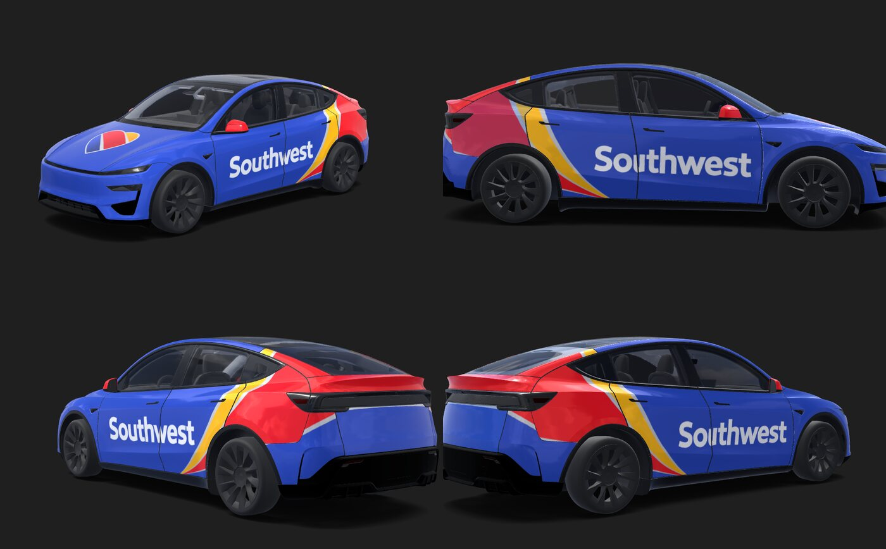

# tesla-southwest-wraps

Digital wraps for Tesla's in-car Paint Shop, styled after the Southwest Airlines 737 "Heart" livery: a Bold Blue body
with the white "Southwest" title, the yellow/red stripes sweeping up to the tail, and the heart on the hood.



## Wraps

| Vehicle                     | Wrap                                                                                                     |
| --------------------------- | -------------------------------------------------------------------------------------------------------- |
| Model Y Performance (2025+) | [`wraps/modely-2025-performance/Southwest_Heart.png`](wraps/modely-2025-performance/Southwest_Heart.png) |

## Install a wrap

Requirements and steps come from Tesla's [custom-wraps repo](https://github.com/teslamotors/custom-wraps).

- **Tesla app** (v4.59.0+): Creations → Wrap → Upload, and pick the PNG.
- **USB drive**: format it exFAT, FAT32/MS-DOS FAT, ext3 or ext4 (not NTFS), create a `Wraps` folder at the root, copy the
  PNG into it and plug it into the car. The drive must not contain map or firmware updates.

Then in the car: Toybox → Paint Shop → Wraps.

To try a wrap on a 3D model first, open the editor for your car on [tesla-wrap.design](https://tesla-wrap.design/editor/modely-2025-performance)
and drop the PNG onto the canvas. The preview above was rendered there.

## Development

Uses [Bun](https://bun.sh). Each wrap is drawn as SVG in template coordinates, then cut to the panel shapes of Tesla's
template for that vehicle.

```bash
bun install
bun run build      # render every wrap into wraps/<model>/
bun test           # check the wraps against Paint Shop's requirements
bun run lint && bun run typecheck && bun run format:check
```

- `src/livery.ts`: palette and shared drawing helpers (title, heart, stripe swoosh).
- `src/models/`: one layout per vehicle, positioned against that vehicle's template.
- `templates/`: Tesla's templates. Add one with `bun run fetch-templates <id>`, where `<id>` is a folder name in
  [teslamotors/custom-wraps](https://github.com/teslamotors/custom-wraps).

## Credits

- Vehicle templates: [teslamotors/custom-wraps](https://github.com/teslamotors/custom-wraps).
- Wordmark and heart: [Southwest Airlines logo (2014)](https://commons.wikimedia.org/wiki/File:Southwest_Airlines_logo_2014.svg)
  on Wikimedia Commons.

This is an unofficial fan project, not affiliated with or endorsed by Southwest Airlines Co. or Tesla, Inc. "Southwest"
and the heart logo are trademarks of Southwest Airlines Co.
